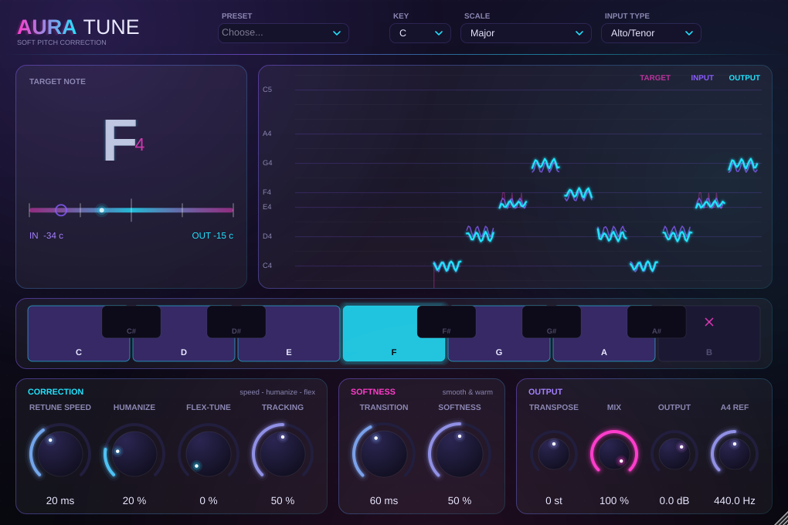

# Aura Tune — мягкий автотюн (VST3, Windows)

Плагин для коррекции высоты голоса в реальном времени. Логика коррекции устроена как у Antares Auto-Tune, а мягкость звучания взята из Waves Tune Real-Time.

## Ручки

**CORRECTION (как в Antares)**

| Ручка | Что делает |
|---|---|
| **Speed** (0–400 мс) | Как быстро голос притягивается к ноте. 0 даёт жёсткий «роботный» тюн, 20–50 мс подходят для поп-музыки, 100+ мс почти незаметны |
| **Amount** | Сила коррекции: 100 % — полностью в ноту, меньше — часть естественной интонации остаётся |
| **Humanize** | Замедляет коррекцию на длинных нотах, поэтому быстрые ноты точные, а протяжные остаются живыми |
| **Flex-Tune** | Исправляет ноту, только когда певец уже близко к ней. Подъезды, скольжения и выразительные отклонения остаются как есть |
| **Tracking** | Строгость детектора высоты. Если голос хриплый или с придыханием, поверните вправо |
| **Key / Scale** | Тональность и лад (мажор, минор, гармонический минор, пентатоники, блюз, дорийский и др.) |
| **Клавиатура** | Клик по ноте убирает её из лада (появится ✕). Ещё один клик возвращает |
| **Input Type** | Тип голоса: сопрано, альт/тенор, низкий мужской или инструмент |

**SOFTNESS (как в Waves)**

| Ручка | Что делает |
|---|---|
| **Transition** (0–500 мс) | Плавный переход между нотами без ступенек |
| **Softness** | Скругляет любые изменения коррекции. Даже при Retune = 0 тюн звучит бархатно, а не «цифрово» |

**DOUBLER**: Double — громкость дублей (0 — выключен), Width — насколько широко они разведены влево-вправо, Detune — насколько свободно дубли «гуляют» относительно основного голоса (в центах). Дублер работает на стерео-дорожке; на моно дубли просто подмешиваются в центр.

**OUTPUT**: Mix (сухой/обработанный) и Output (громкость). В верхней строке: Transpose (±12 полутонов) и A4 Ref (строй, 430–450 Гц) — тяните мышью, двойной клик сбрасывает.

**Пресеты**: Natural Pop, Smooth R&B, Gentle Ballad, Melodic Trap, Hard Tune, Transparent Fix, Wide Pop Double.

## Как устроен звук

- **Детектор высоты**: алгоритм YIN.
- **Сдвиг высоты**: TD-PSOLA. Тембр (форманты) сохраняется сам, поэтому голос не становится «бурундучьим».
- **Задержка**: около 31 мс. Плагин сообщает её DAW, и та сама выравнивает дорожки.
- **Нагрузка**: около 5 % одного ядра.
- **Каналы**: моно и стерео. Стерео суммируется в моно, потому что вокал моно.

## Сборка под Windows

### Вариант A: на своём компьютере

1. Установите **Visual Studio 2022 Community** (бесплатно). В установщике отметьте «**Desktop development with C++**», CMake входит в этот набор.
2. Установите **Git** (git-scm.com). Он нужен, чтобы при первой сборке скачался JUCE.
3. Дважды кликните **`build_windows.bat`**. Лучше запускать «от имени администратора», тогда плагин сам скопируется в папку VST3.
4. В DAW (FL Studio, Ableton, Reaper, Cubase…) пересканируйте плагины. Появится **Aura Tune**.

Готовый плагин: `build\AuraTune_artefacts\Release\VST3\Aura Tune.vst3`.
Ещё собирается отдельная программа `build\AuraTune_artefacts\Release\Standalone\Aura Tune.exe`, чтобы попробовать тюн с микрофоном без DAW.

### Вариант B: без установки Visual Studio (через GitHub)

1. Создайте репозиторий на github.com и загрузите туда эту папку.
2. Откройте вкладку **Actions**. Сборка запустится сама и займёт около 10 минут.
3. Скачайте архив **AuraTune-Windows** со страницы сборки.
4. Скопируйте `Aura Tune.vst3` в `C:\Program Files\Common Files\VST3`.

## Советы

- Ставьте Aura Tune **первым** в цепочке вокала, до компрессора и ревербератора.
- Записывайте вокал сухим. Ревер и дилей на входе мешают определять высоту.
- Если плагин «скачет» между нотами, укажите правильную тональность или уберите лишние ноты на клавиатуре.

## Для разработчика

- `Source/TuneEngine.h`: весь DSP на чистом C++ без JUCE.
- `tests/engine_test.cpp`: офлайн-тесты. Сборка: `g++ -O2 -std=c++17 tests/engine_test.cpp`.
- `Source/PluginEditor.*` и `Source/NeonLookAndFeel.h`: интерфейс.

Плагин построен на JUCE 8 (лицензия AGPLv3 или коммерческая). Для личного использования это бесплатно. Если будете продавать плагин, нужна лицензия JUCE.
